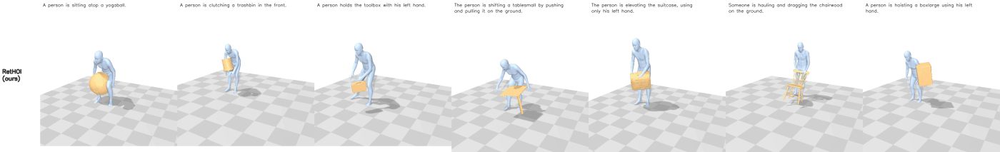
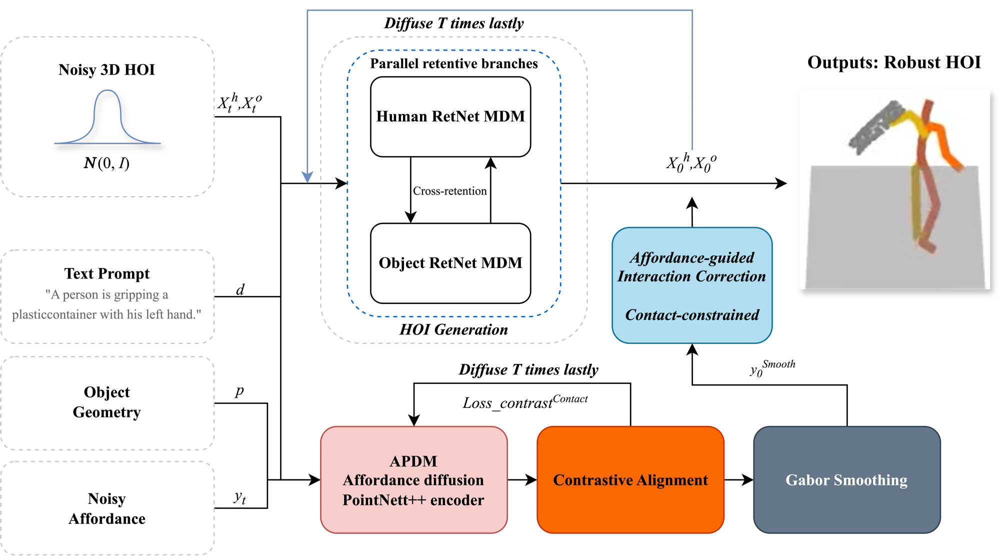
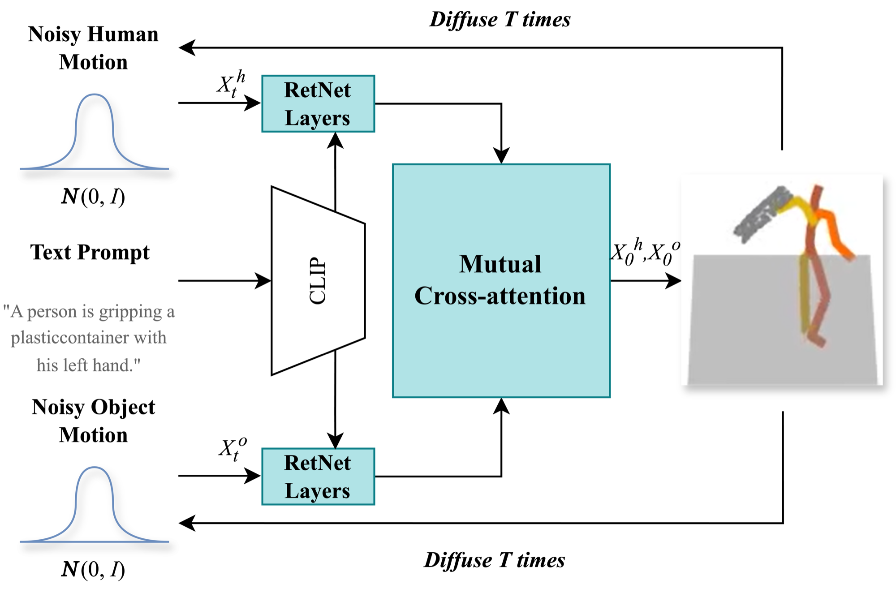
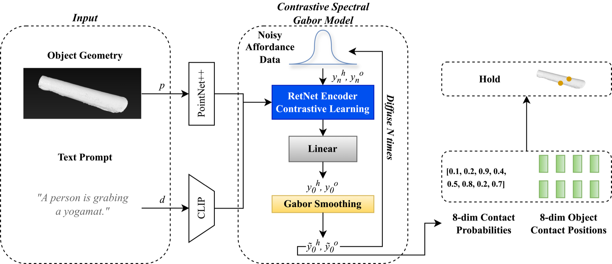
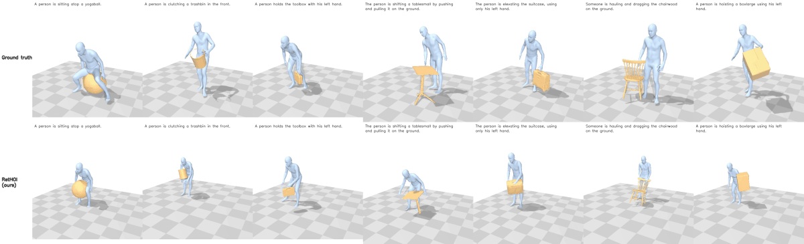

<div align="center">

# RetHOI

### Text-Driven 3D Human-Object Interaction via Parallel Retentive Diffusion and Spectral Refinement

**Hongtao Xie** · Supervised by **Prof. Amy Hui Zhang**

Beijing Normal – Hong Kong Baptist University (BNBU) · Bachelor's Thesis, 2025

<a href="#-citation"></a>




*"A person is sitting atop a yogaball." · "…clutching a trashbin in the front." · "…holds the toolbox with his left hand." · and more, all generated from text alone.*

</div>

---

## 📖 Abstract

We present **RetHOI**, a framework for generating realistic 3D human-object interactions (HOIs) from natural-language descriptions. Existing diffusion-based approaches suffer from three limitations: the quadratic cost of Transformer attention, which restricts temporal sequence modeling; jittery contact trajectories, which undermine physical plausibility; and semantic drift between the text description and the generated motion. RetHOI addresses these limitations with three components built on top of HOI-Diff. First, the human and object motions are synthesized by parallel **retentive** branches whose multi-scale retention, with learnable exponential decay, captures both short-term contact dynamics and long-term trajectory patterns; the branches exchange information through bidirectional **cross-retention**. Second, the contact trajectories used for affordance-guided correction are refined by a bank of **multi-scale, multi-orientation Gabor filters** with learnable fusion weights, which attenuates high-frequency jitter while preserving the motion. Third, **InfoNCE contrastive alignment** with CLIP text embeddings is applied at both the affordance-prediction and the motion-synthesis stage. We evaluate the framework on the BEHAVE dataset with a full set of ablations.

## 🧠 Method

<div align="center"></div>

| Component | Description | Code |
|---|---|---|
| **Parallel Retentive Diffusion Model (PRDM)** | The Transformer branches of the HOI diffusion model are replaced with RetNet layers: multi-scale retention with 4 heads whose decay rates are learnable and initialised to γ = 0.85 / 0.90 / 0.95 / 0.98, a SwiGLU feed-forward network, and GroupNorm with a swish output gate. The human and object branches communicate through cross-retention, `H_out = H + 0.5 · Retention(Q_h, K_o, V_o)`. | [`model/retnet.py`](model/retnet.py), [`model/hoi_diff.py`](model/hoi_diff.py) |
| **Multi-scale Gabor smoothing** | A bank of 40 Gabor kernels (λ ∈ {3, 5, 7, 9, 11} frames × 8 orientations θ = kπ/8, σ = 0.5λ, γ = 0.5, kernel size 11, reflection padding) fused with learnable factorised weights softmax(w_s)·softmax(w_o). It smooths the contact trajectories used by the affordance-guided correction and, with a learnable blend, the clean motion predicted by PRDM. | [`model/gabor.py`](model/gabor.py), [`sample/condition.py`](sample/condition.py) |
| **Dual-stage contrastive alignment** | Pooled affordance features, and the averaged pooled human and object features, are projected by a two-layer MLP into the CLIP space and aligned with the frozen CLIP text embedding by a symmetric InfoNCE loss (τ = 0.07). Identical captions within a batch are treated as positives. | [`model/contrastive.py`](model/contrastive.py) |

**Training objective.** `L = L_diffusion + λ₁ L_contrast + λ₂ L_smooth`, with λ₁ = 0.1, λ₂ = 0.05 and `L_smooth = E‖x̂_{t+1} − x̂_t‖²`.

<details>
<summary><b>Architecture figures</b></summary>

| PRDM (HOI generation) | CSGM / APDM (affordance prediction) |
|---|---|
|  |  |

</details>

## 🎬 Qualitative Results

Seven BEHAVE test prompts, one per object category. Top row: ground truth; bottom row: RetHOI. The generated joints are fitted with SMPLify to obtain SMPL body meshes, and the scanned object mesh is placed with the generated 6-DoF pose.

<div align="center"></div>

Full-resolution video: [`assets/comparison.mp4`](assets/comparison.mp4). Individual clips: [`assets/videos/`](assets/videos).

## 📊 Quantitative Results

⏳ The full test-set evaluation of all five models (RetHOI, HOI-Diff and three ablations) is being finalised; this section will be updated with the measured numbers.

## 🛠️ Setup

### 1. Environment

Tested on Ubuntu 24.04 with Python 3.10, PyTorch 2.1.2 and CUDA 11.8 (GTX 1080 / 1080 Ti / RTX 2080 Ti).

```bash
git clone https://github.com/Eric031212/RetHOI.git && cd RetHOI
bash scripts/setup_env.sh        # creates the conda env `rethoi`
conda activate rethoi
```

### 2. Data and models

No data is distributed with this repository. All required files come from the following sources:

| What | Source | How |
|---|---|---|
| BEHAVE 30 fps SMPL + object parameters (`behave-30fps-params-v1.tar`) and object scans (`objects.zip`) | [BEHAVE](https://virtualhumans.mpi-inf.mpg.de/behave/license.html), Bhatnagar et al., CVPR 2022 (accept the licence first) | extract to `dataset/raw_data/behave_raw/<sequence>/` and `dataset/raw_data/behave_objects/<object>/` |
| Text annotations, train/test split, object sampling indices, BPS basis | [HOI-Diff](https://github.com/neu-vi/HOI-Diff), Peng et al. | `bash scripts/fetch_annotations.sh` |
| SMPL+H body model ("Extended SMPL+H model", `smplh.tar.xz`) | [MANO / SMPL+H](https://mano.is.tue.mpg.de) (registration required) | `python scripts/prepare_smplh.py /path/to/extracted/smplh` |
| SMPL (for SMPLify / rendering), GloVe, pretrained MDM (`humanml_trans_enc_512`) | [MDM](https://github.com/GuyTevet/motion-diffusion-model), Tevet et al. | `bash scripts/download_deps.sh` |

Then preprocess BEHAVE into the HumanML3D-style HOI representation (263-d human + 6-d object per frame) and extract the contact affordances:

```bash
bash scripts/preprocess_behave.sh   # → dataset/behave_t2m/{sequences, sequences_263_rep, affordance, object_mesh}
python -m tests.smoke_test          # optional: checks every component on random tensors
```

## 🚀 Usage

**Train** (all runs on a Slurm cluster, or individually):

```bash
bash scripts/run_experiments.sh     # 2 APDMs, HOI-Diff baseline, RetHOI, 3 ablations, evaluator

# affordance model with contrastive alignment
python -m train.train_affordance --save_dir save/apdm_con --dataset behave --batch_size 32 \
    --diffusion_steps 500 --num_steps 10000 --use_contrastive --lambda_con 0.1
# RetHOI motion model
python -m train.train_hoi_diff --save_dir save/rethoi --dataset behave --batch_size 32 --num_steps 20000 \
    --arch retnet --use_gabor --use_contrastive --lambda_con 0.1 --lambda_smooth 0.05
```

**Generate and evaluate:**

```bash
python -m eval.evaluator --save_path checkpoints/behave_evaluator.pt        # text-motion evaluator
python -m sample.generate_eval --model_path save/rethoi/model000020000.pt \
    --afford_model_path save/apdm_con/model000010000.pt --guidance --out results/rethoi.npz
python -m eval.eval_behave --samples results/rethoi.npz --names RetHOI
```

**Render meshes** (SMPL body + object, headless via OSMesa):

```bash
python -m visualize.render_hoi --samples results/rethoi.npz --indices 0 1 2 --out_dir renders/rethoi
bash scripts/render_showcase.sh 6   # the videos in this README
```

<details>
<summary><b>All flags</b></summary>

| Flag | Meaning |
|---|---|
| `--arch {retnet, trans_enc}` | PRDM (RetNet) or the original HOI-Diff Transformer |
| `--use_gabor` | Gabor smoothing of the predicted motion and of the guidance contact trajectories |
| `--use_contrastive`, `--lambda_con` | InfoNCE alignment and its weight (APDM and HOI-DM) |
| `--lambda_smooth` | weight of the temporal smoothness loss |
| `--causal_retention` | causal decay mask γ^(i−j), i ≥ j; the default is the bidirectional γ^\|i−j\|, because the denoiser sees the whole sequence |
| `--guide_human_scale`, `--guide_obj_scale` | guidance strengths τ₁ (default 1) and τ₂ (default 10) |
| `--showcase N`, `--showcase_objects …` | generate only N long test sequences with distinct objects (for videos) |

</details>

## 📁 Repository Structure

```
model/        retnet.py · gabor.py · contrastive.py · hoi_diff.py (PRDM) · afford_est.py (APDM) · pointnet2_torch.py
diffusion/    Gaussian diffusion with the diffusion / contrastive / smoothness losses and affordance guidance
train/        training entry points and loop
sample/       generate_eval.py (APDM → guided PRDM sampling) · condition.py (Gabor-smoothed contact guidance)
eval/         evaluator.py (text-motion evaluator) · eval_behave.py (FID, R-Precision, Diversity, Contact, Foot skating)
visualize/    render_hoi.py (SMPLify + pyrender mesh videos) · make_grid.py · joints2smpl/
process/      BEHAVE preprocessing (from HOI-Diff, fixed and parallelised)
scripts/      environment, data, Slurm experiment, evaluation and rendering pipelines
```

## 🔧 Changes to the HOI-Diff Codebase

The public HOI-Diff release could not be run end to end. The following corrections were required; they are applied to the baseline and to RetHOI alike.

- **Object frame.** BEHAVE object poses refer to the template centred at its vertex mean, but the released preprocessing exported the raw template. Every object point cloud was therefore displaced by approximately 0.6 m, which corrupted the contact labels (the hand-contact rate rose from 17 % to about 70 % after the correction).
- **Affordance format.** `get_affordance.py` stores 8 joints as `(flag, x, y, z)`, whereas the APDM dataset indexed 22 joints in `(x, y, z, flag)` order; every APDM training sample was silently discarded.
- **Diffusion schedule.** The APDM was trained with a 1000-step schedule and sampled with a 500-step one.
- **Guidance.** Samples without any predicted contact were pulled towards an arbitrary object point, and the guidance retained its autograd graph across all steps (GPU memory leak).
- **Missing evaluator.** HOI-Diff did not release its BEHAVE evaluator; `eval/` provides one. Its text encoder is GloVe + BiGRU rather than CLIP, so that it cannot favour the CLIP-space contrastive loss. Consequently, the numbers reported here are not directly comparable with those printed in the HOI-Diff paper.
- **Robustness.** Training now stops at `--num_steps`; the sampling script, broken imports, deprecated NumPy aliases, the missing PointNet++ import (with a pure-PyTorch fallback) and the `bps_torch` build dependency were fixed.

## 📝 Citation

If you find this work useful, please cite it (GitHub's **"Cite this repository"** button, generated from [`CITATION.cff`](CITATION.cff), gives the same entry):

```bibtex
@mastersthesis{xie2025rethoi,
  title  = {{RetHOI}: Text-Driven {3D} Human-Object Interaction via Parallel Retentive Diffusion and Spectral Refinement},
  author = {Xie, Hongtao},
  school = {Beijing Normal--Hong Kong Baptist University},
  type   = {Bachelor's Thesis},
  year   = {2025},
  note   = {Supervised by Hui Zhang},
  url    = {https://github.com/Eric031212/RetHOI}
}
```

RetHOI builds on HOI-Diff; please also cite:

```bibtex
@inproceedings{peng2025hoi,
  title     = {{HOI-Diff}: Text-Driven Synthesis of {3D} Human-Object Interactions using Diffusion Models},
  author    = {Peng, Xiaogang and Xie, Yiming and Wu, Zizhao and Jampani, Varun and Sun, Deqing and Jiang, Huaizu},
  booktitle = {Proceedings of the Computer Vision and Pattern Recognition Conference (CVPR) Workshops},
  pages     = {2878--2888},
  year      = {2025}
}
```

## 🙏 Acknowledgements

Huge thanks to **Prof. Amy Hui Zhang** 🎓, my supervisor. Her guidance (and patience 😅) turned a vague idea about "making HOI-Diff better" into a full thesis.

To my **family and friends** 💛: thank you for the encouragement, the warm company, and for listening to me explain what a "retention mechanism" is more times than anyone should.

And of course, to the **countless cups of coffee** ☕☕☕ that fuelled this research. :D

This project stands on the shoulders of giants 🧱: [HOI-Diff](https://github.com/neu-vi/HOI-Diff), [MDM](https://github.com/GuyTevet/motion-diffusion-model), [RetNet / torchscale](https://github.com/microsoft/torchscale), [BEHAVE](https://github.com/xiexh20/behave-dataset), [CLIP](https://github.com/openai/CLIP), [text-to-motion](https://github.com/EricGuo5513/text-to-motion), [joints2smpl](https://github.com/wangsen1312/joints2smpl) and the PyTorch community 🔥. Big respect to everyone who open-sources their code. 🫡

## 📜 License

Code is released under the [MIT License](LICENSE), inherited from MDM / HOI-Diff. BEHAVE, SMPL+H, SMPL and the HOI-Diff annotations are subject to their own licences and are **not** redistributed here.

<div align="center"><sub>Made with ☕ and way too many GPU hours. ⚡</sub></div>
